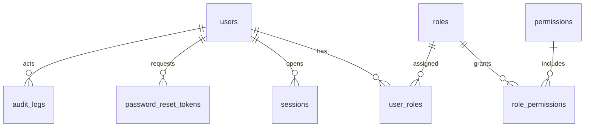
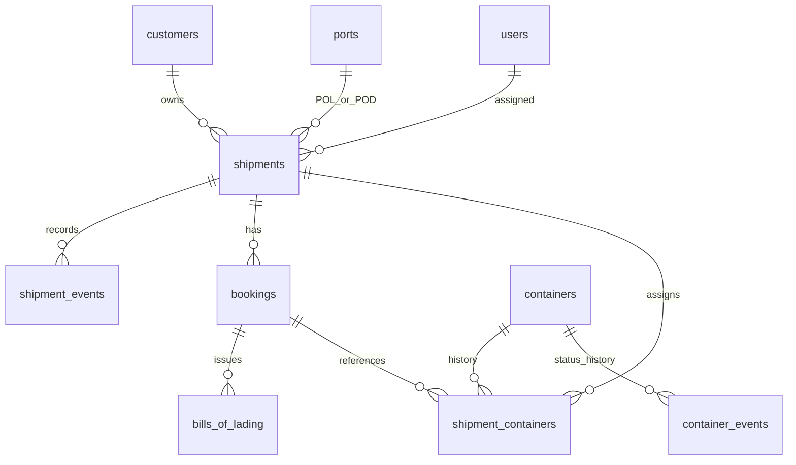
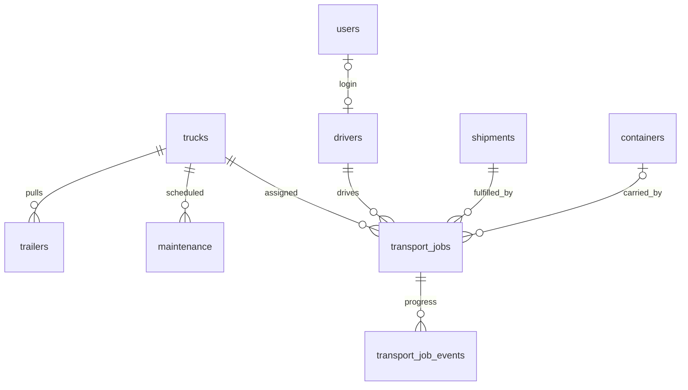
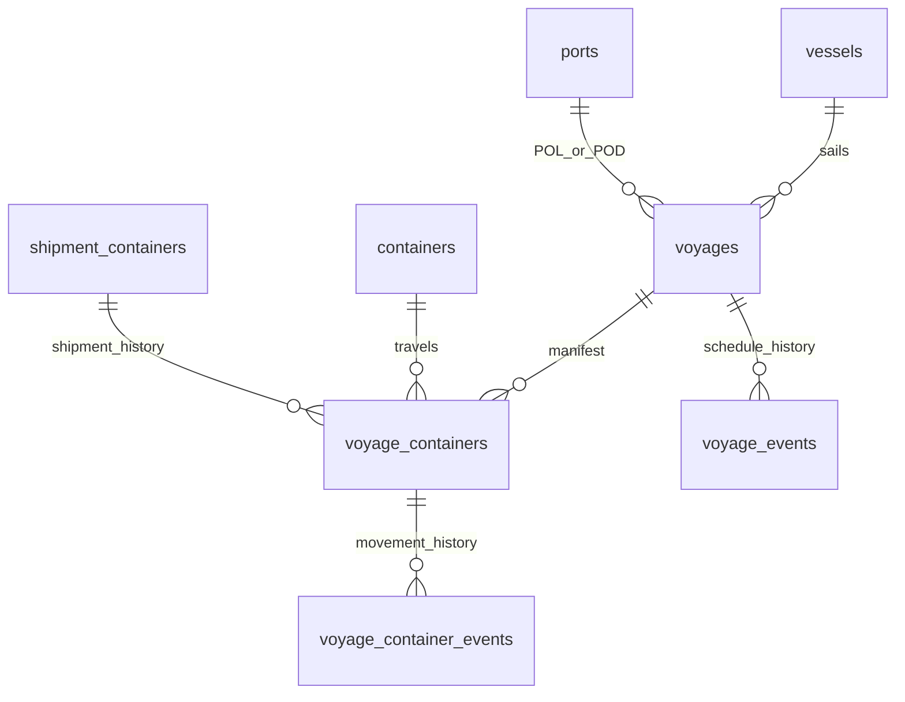
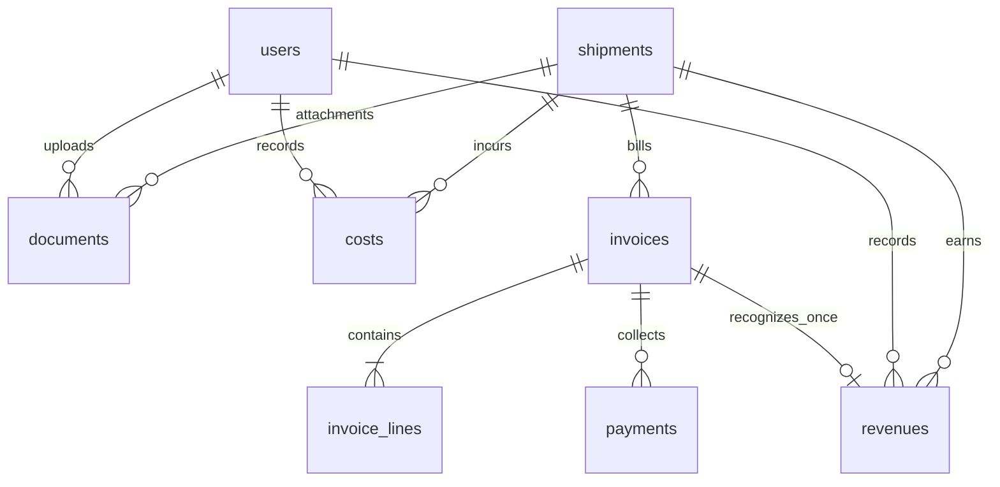

# Kiến trúc và lộ trình

## Ranh giới module

- `apps/web`: giao diện Next.js; gọi API với cookie session.
- `apps/api`: NestJS; xác thực, RBAC, validation, audit và nghiệp vụ.
- `apps/api/prisma`: schema và migration PostgreSQL.
- Giai đoạn 5: `tracking` gọi interface `AisProvider`, lưu vị trí kèm nguồn và thời gian cập nhật. Map Provider chỉ hiển thị tọa độ đó.

## Quan hệ giai đoạn 1

Session và reset token chỉ lưu SHA-256 của token ngẫu nhiên. Mật khẩu dùng Argon2id. Quyền kiểm tra phía API trên từng request. Đổi/đặt lại mật khẩu thu hồi toàn bộ session. Audit log không có endpoint xóa.

## Quan hệ đã triển khai ở giai đoạn 2

`shipment_containers` giữ lịch sử bằng `assigned_at` và `released_at`; unique index một phần chỉ cho phép một liên kết đang hoạt động cho mỗi container. `container_events` và `shipment_events` lưu thời điểm, người cập nhật, ghi chú; các thay đổi quan trọng đồng thời ghi `audit_logs`. Tọa độ AIS chỉ được lưu từ provider thật trong module tracking riêng; không sinh vị trí giả.

## Quan hệ giai đoạn 3

Mỗi chuyến lưu khoảng thời gian `[pickup_at, delivery_at)`. Tạo chuyến khóa hàng xe và tài xế trong giao dịch, rồi kiểm tra các chuyến đang mở và lịch bảo dưỡng giao nhau. Hồ sơ tài xế có thể liên kết một tài khoản `DRIVER`; endpoint `/my-jobs` lọc bằng liên kết này ở database. Tiến độ và các thay đổi đội xe đều ghi audit log.

## Quan hệ giai đoạn 4

`voyage_containers` liên kết Voyage với lần gán Container đang hoạt động trong `shipment_containers`. Một Container có thể đi qua nhiều Voyage khi chuyển tải; cùng Container không thể xuất hiện hai lần trên một Voyage. Thay đổi lịch Voyage và sự kiện manifest được ghi audit. Các bảng này không chứa vị trí AIS.

## Lộ trình migration

| Giai đoạn | Bảng bổ sung chính |
|---|---|
| 2 | customers, shipments, shipment_events, bookings, bills_of_lading, containers, shipment_containers, container_events, ports |
| 3 | trucks, trailers, drivers, transport_jobs, transport_job_events, maintenance |
| 4 | vessels, voyages, voyage_events, voyage_containers, voyage_container_events |
| 5 | vessel_positions |
| 6 | documents, costs, revenues, invoices, invoice_lines, payments |
| 7 | alerts |

Đường tra cứu container: `containers → shipment_containers → shipments → bookings/B/L`, `voyage_containers → voyages → vessels`, cùng `transport_jobs`, `documents` và `costs/revenues`. Giai đoạn 5 bổ sung `vessel_positions` qua AIS provider; API vẫn trả **AIS DATA NOT CONNECTED** khi chưa cấu hình provider và không tạo vị trí giả.

## Tracking AIS (giai đoạn 5)

`tracking/ais-provider.ts` khai báo hợp đồng AIS chuẩn hóa; `tracking/aisstream.provider.ts` giữ riêng giao thức WebSocket của provider. `TrackingService` quản lý subscription cho MMSI đã đăng ký, lưu quan sát vị trí vào `vessel_positions` và truy vấn tàu `DEPARTED` có container `LOADED`. Frontend `/live-map` tiêu thụ `/tracking/live`; adapter map `web/src/lib/map-provider.ts` chỉ dựng bản đồ Google Maps từ tọa độ AIS đã lưu, ETA và cảng lịch trình lấy riêng từ Voyage. API key ở `apps/api/.env`, không truyền tới trình duyệt. Không có tọa độ AIS khi provider chưa cấu hình.

## Quan hệ tài chính và chứng từ (giai đoạn 6)

`documents` giữ metadata và khóa file ngẫu nhiên; file nằm ngoài web root, endpoint tải yêu cầu xác thực. `costs`, `revenues`, `invoices` và `payments` dùng Decimal cho số tiền, lưu mã tiền tệ trên từng bút toán. Dashboard chỉ cộng và tính lợi nhuận trong cùng tiền tệ. Phát hành hóa đơn, tạo revenue tương ứng và ghi Audit Log trong một transaction; thanh toán và thay đổi trạng thái hóa đơn cũng là transaction. `revenues.invoice_id` unique đảm bảo mỗi hóa đơn chỉ sinh doanh thu một lần. Ghi chứng từ, chi phí, doanh thu, hóa đơn và thanh toán được ghi Audit Log; API thông thường không có chức năng xóa bút toán hoặc Audit Log.

## Cảnh báo và báo cáo (giai đoạn 7)

`alerts.source_key` duy nhất khử trùng lặp phát hiện từ Shipment, Voyage/AIS, Transport Job, hồ sơ xe/tài xế, lịch bảo dưỡng và trạng thái Container. Detector đối chiếu lúc API khởi động, mỗi 5 phút và mỗi lần đọc `/alerts`, cập nhật `last_seen_at`, và đánh dấu `RESOLVED` khi điều kiện cảnh báo đã hết; xác nhận của người dùng giữ `ACKNOWLEDGED` trong khi điều kiện còn tồn tại. `reports.view` giới hạn báo cáo theo vai trò. KPI và trend được nhóm theo kỳ, còn tiền luôn được nhóm theo currency để tránh cộng các đơn vị khác nhau. Không tự ước lượng Demurrage/Detention khi thiếu free time thực tế.
